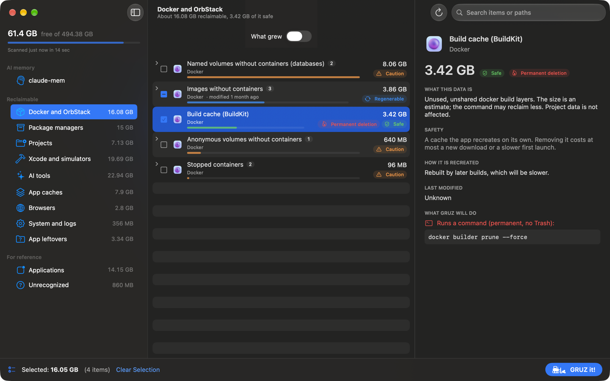
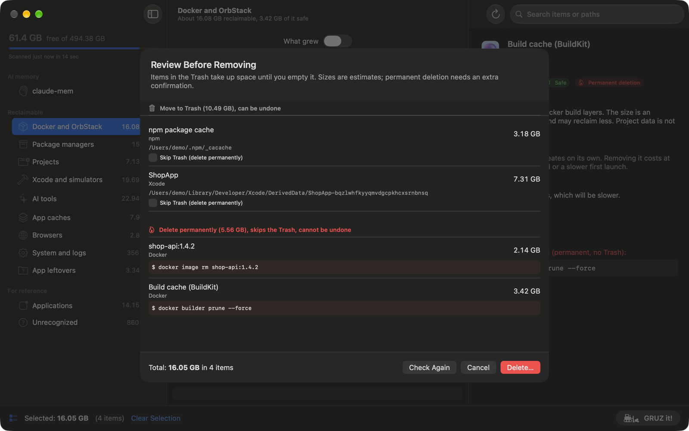
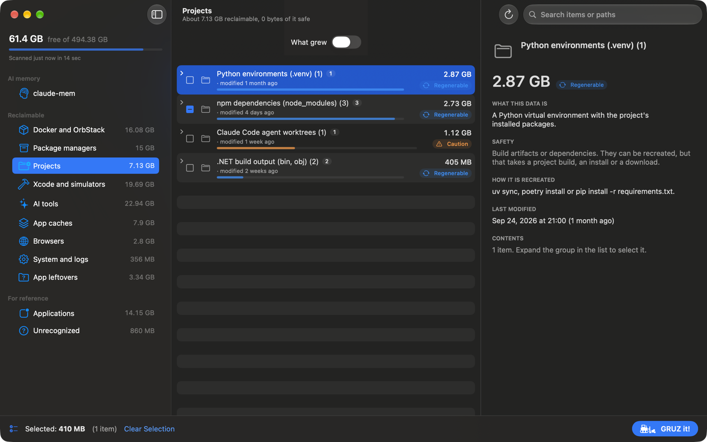
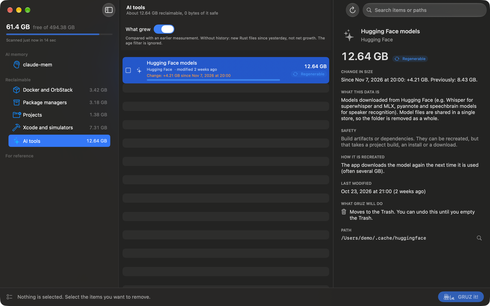
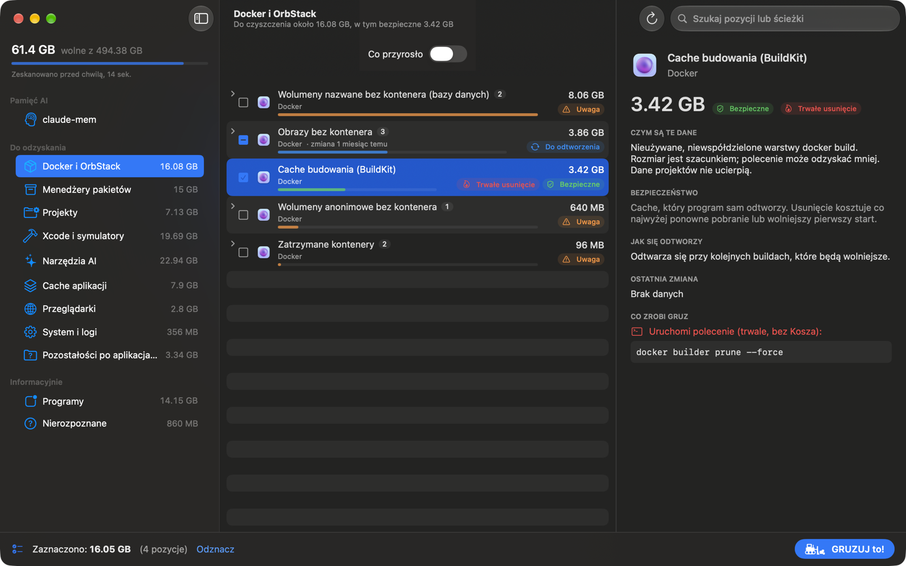

<div align="center">


# GRUZ

### Godlike Rubbish Ultra-Zapper

A macOS app that digs through caches, build junk, Docker leftovers and remains of apps you
uninstalled years ago, tells you what each item is, and zaps only what you approve.
**Trash first, no surprises.**

[](https://github.com/macolszewski/gruz_cleaner/actions/workflows/ci.yml)
[](./LICENSE)
[](#install)
[](./Package.swift)
[](#how-it-works)
[](https://macolszewski.github.io/gruz_cleaner/reference/localization/)

[Features](#features) ·
[Screenshots](#screenshots) ·
[Safety](#how-gruz-keeps-your-data-safe) ·
[Install](#install) ·
[Build from source](#build-from-source) ·
[Documentation](https://macolszewski.github.io/gruz_cleaner/) ·
[Contributing](#contributing)

<br>



</div>

> *Gruz* is Polish for rubble: what is left behind once the building is done. Your disk has
> plenty of it.

## Why GRUZ

Developer Macs fill up with things nobody remembers creating: Docker images from last year's
project, Xcode DerivedData for apps that no longer exist, a dozen `node_modules`, model caches
of AI tools, and support files of apps you uninstalled long ago. Generic cleaners either miss
them or delete them without telling you what they were.

- **It explains.** Every item says what the data is, how risky removing it is and how it comes
  back, in plain words. Over 100 known locations are described in a reviewed rule catalog.
- **It asks.** Nothing is preselected. *GRUZ it!* opens a review of every exact path and
  command before anything runs, and files go to the Trash first.
- **It knows developer tools.** Docker and OrbStack through the `docker` CLI, Rust `target`
  profiles, Xcode and simulators, package manager caches, agent worktrees, claude-mem.

## Features

<table>
<tr>
<td width="50%" valign="top">

#### Find the rubble

- **Docker and OrbStack:** unused images, stopped containers, unused volumes and BuildKit
  cache, read from `docker system df`.
- **Package managers:** npm, pnpm, Yarn, Bun, uv, pip, Homebrew, CocoaPods, Gradle, Maven,
  NuGet, Go, Dart, the Cargo registry and more.
- **Xcode and Android:** DerivedData, device support files, archives, simulators, emulator
  and system images.
- **AI tools:** Hugging Face, Ollama and LM Studio models, old Claude Code and Codex versions
  and sessions.

</td>
<td width="50%" valign="top">

#### Clean your projects

- **Project artifacts** in your code folders: `node_modules`, `.venv`, `bin`/`obj`, Gradle,
  Flutter and web build output, recognized by context (a `package.json` next to
  `node_modules`, a `pyvenv.cfg` inside `.venv`).
- **Rust and Cargo:** `target` split by profile and component, release binaries kept, active
  builds detected through the Cargo lock.
- **Agent worktrees** of Claude Code and Codex, with their `git status`.
- **What grew:** compare with earlier scans and see only what got bigger.

</td>
</tr>
<tr>
<td valign="top">

#### Understand every item

- Plain description, safety level and how the data comes back.
- **Safe**, **Regenerable**, **Caution** and **User data** badges.
- **App leftovers:** data of apps that are no longer installed.
- **Unrecognized:** large folders no rule describes, shown but never removable.

</td>
<td valign="top">

#### Remove on your terms

- Review sheet with exact paths, commands and the total.
- Trash by default; permanent removal marked in advance and confirmed twice.
- Owner apps must be closed; every operation is logged.
- English and Polish, following macOS or chosen in Settings.

</td>
</tr>
</table>

## Screenshots

<table>
<tr>
<td width="50%"><br><sub><b>Review sheet</b>: every path and command, Trash and permanent operations apart.</sub></td>
<td width="50%"><br><sub><b>Project artifacts</b> found by context in your code folders.</sub></td>
</tr>
<tr>
<td><br><sub><b>What grew</b> since an earlier scan of the same folders.</sub></td>
<td><br><sub><b>Po polsku</b>: the interface and the rule catalog are fully translated.</sub></td>
</tr>
</table>

Screenshots show fictional demo data; `scripts/screenshots.sh` regenerates them.

## How GRUZ keeps your data safe

| Guarantee | How |
|---|---|
| Scanning never changes anything | The scanner module has no code path that removes files or runs state-changing commands. |
| You see exactly what will happen | The review sheet lists every path and command with its size before you confirm. |
| Trash first | Files are moved to the Trash. Permanent operations (Docker commands, a tool's own clean command, *Skip Trash*) are marked in advance and need a second confirmation. |
| Protected paths always win | A hard-coded denylist (your home folder, Documents, Desktop, `.git` folders, project sources, system folders) overrides every rule. |
| Nothing runs behind your back | No CLI flag, URL scheme or script can remove anything. `gruz-scan` does not even link the module that can. |
| Every step is checked twice | Paths, running apps and commands are checked when the review opens and again right before each operation, and every result goes to `~/Library/Logs/GRUZ/operations.log`. |

Details: [architecture and safety model](https://macolszewski.github.io/gruz_cleaner/reference/architecture/).

## Install

Download `GRUZ-<version>.zip` from the [latest release](https://github.com/macolszewski/gruz_cleaner/releases/latest),
unzip it and move `GRUZ.app` to Applications. Builds are not notarized yet, so on the first
start Control-click the app and choose **Open**.

For the full picture (Trash, Mail, Messages, iPhone backups) grant **Full Disk Access** in
System Settings > Privacy & Security. GRUZ works without it and tells you what it could not
measure.

## Build from source

You need macOS 15 or later and Xcode 26 (Swift 6.2).

```bash
git clone https://github.com/macolszewski/gruz_cleaner.git
cd gruz_cleaner
./scripts/build-app.sh          # builds build/GRUZ.app
open build/GRUZ.app
```

The script signs with your first *Apple Development* certificate, so macOS keeps the Full Disk
Access grant across rebuilds. Without one the app is signed ad hoc and the permission has to be
granted again after each build. `SIGN_IDENTITY`, `BUNDLE_ID` and `VERSION` override the
defaults.

## Command line

`gruz-scan` prints the same read-only scan in the terminal or as JSON:

```bash
swift run gruz-scan                        # summary by category
swift run gruz-scan --children             # with nested items
swift run gruz-scan --json > scan.json     # machine-readable
swift run gruz-scan --root ~/code --root ~/work
```

## How it works

| Module | Role |
|---|---|
| `ScannerKit` | Read-only scan: rule catalog, Docker, simulators, project artifacts, app leftovers. |
| `CleanerKit` | The only module that removes data, and it checks every operation again before running it. |
| `GRUZ` | The SwiftUI app. |
| `gruz-scan` | Report CLI, without access to `CleanerKit`. |

Known locations are JSON rules in [`Sources/ScannerKit/Rules`](Sources/ScannerKit/Rules), so
teaching GRUZ a new cache needs no Swift. See the [rule catalog reference](https://macolszewski.github.io/gruz_cleaner/reference/rules/).

## Documentation

The site at **<https://macolszewski.github.io/gruz_cleaner/>** is built with MkDocs from
[`docs/`](docs):

- [User guide](https://macolszewski.github.io/gruz_cleaner/guide/getting-started/): scanning,
  categories, removing, What grew, Rust, claude-mem, settings and the CLI.
- [Reference](https://macolszewski.github.io/gruz_cleaner/reference/architecture/):
  architecture, rule catalog, localization, limitations and FAQ.

Preview it locally with `pip install -r docs/requirements.txt && mkdocs serve`.

## Contributing

New rules, translations and bug reports are welcome. Read [CONTRIBUTING.md](CONTRIBUTING.md)
for the setup and conventions and [AGENTS.md](AGENTS.md) for the architecture rules. Report
anything that could lead to data loss privately, as described in [SECURITY.md](SECURITY.md).

```bash
swift test
python3 -m unittest discover -s Tests/ClaudeMemoryReindexTests
./scripts/check-localizations.py
```

## License

GRUZ is created by [Maciej Olszewski](https://github.com/macolszewski) and released under the
[MIT License](LICENSE).
