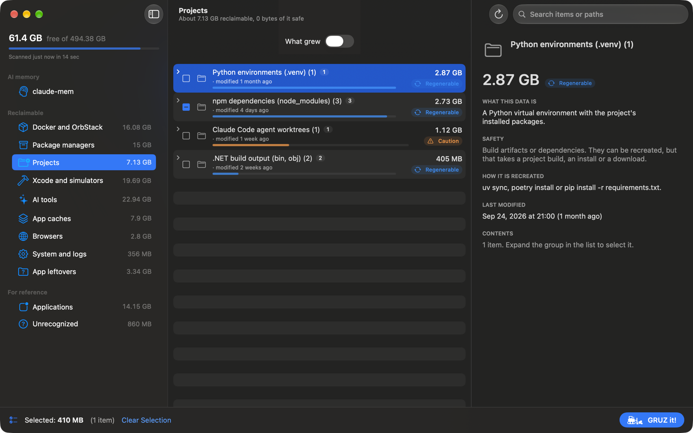

# Categories

GRUZ sorts everything it finds into categories in the sidebar. Most items come from the
[rule catalog](../reference/rules.md), a list of known locations with a description, a safety level
and a removal action for each. Docker, simulators, project folders, Rust targets, app leftovers,
applications and unrecognized folders have their own scanners.

This page describes what each category contains. The descriptions in the app are more specific:
select an item to read what it is and how it comes back.

## Safety levels

Every item has one of four safety levels, shown as a badge and as the color of its size bar.

| Level | Meaning |
|---|---|
| **Safe** | A cache the app recreates on its own. Removing it costs at most a new download or a slower first launch. |
| **Regenerable** | Build artifacts or dependencies. They can be recreated, but that takes a project build, an install or a download. |
| **Caution** | May contain data that cannot be recreated (databases, sessions, settings). Remove it only if you know what it is. |
| **User data** | Your data. It is shown for information only and cannot be removed with GRUZ. |

The level reflects the worst realistic case, not the common one. Session transcripts, archives,
backups, emulator disks and anything that may hold a database are **Caution**.

An item without a removal action, such as a **User data** item or anything in Applications and
Unrecognized, shows a lock instead of a checkbox.

## Reclaimable

### Docker and OrbStack

Read from `docker system df`, so Docker Desktop or OrbStack must be running. If Docker does not
respond, the sidebar shows a warning and only the disk image is listed.

| Item | Safety | Removal |
|---|---|---|
| Images without containers | Regenerable | `docker image rm`, sized by the image's unique layers |
| Stopped containers | Caution | `docker container rm`; changes written inside the container are lost, volumes stay |
| Anonymous volumes without containers | Caution | `docker volume rm`; may hold test database data |
| Named volumes without containers (databases) | Caution | `docker volume rm`; usually databases and project files |
| Build cache (BuildKit) | Safe | `docker builder prune --force`, counting only records that are neither in use nor shared |
| OrbStack virtual machine disk image, Docker Desktop data | User data | Not removable; shown so you can see where the space is |

All Docker removals are commands, so they are permanent and need the extra confirmation described in
[Removing items](removing.md#permanent-deletion). Named volumes are always **Caution**: "not attached
to any container" does not mean "not needed". OrbStack returns the freed space to macOS gradually
after the commands finish.

### Package managers

Caches and downloads of package managers and toolchains: npm (and `npx` packages older than 30 days),
pnpm, Yarn, Bun, uv, pip, the system Python cache, Homebrew, CocoaPods, Swift Package Manager, Go,
Gradle, Maven, NuGet, Dart pub, the Cargo registry, Playwright and Puppeteer browsers, and old
versions kept by nvm and FVM.

Most are **Safe** or **Regenerable** and move to the Trash. The uv cache is cleared with
`uv cache clean` instead, because uv keeps its cache consistent that way; the command is permanent. Tools and
Python versions installed by uv are **Caution**. The currently installed Node.js (nvm) and a locally
installed .NET SDK are shown as **User data**.

For tools with several installed versions (Playwright browsers, Node.js under nvm, Flutter SDKs under
FVM), GRUZ keeps the newest version and offers the older ones. It cannot tell which version a project
still uses.

### Projects

Folders inside your [project folders](settings.md#scanning) that a build or install recreates. A
folder name alone is not enough: GRUZ checks what is next to it or inside it.

| Item | Recognized when |
|---|---|
| `node_modules` | next to `package.json` |
| `.venv`, `venv`, `env`, `.env` | contains `pyvenv.cfg` |
| `bin`, `obj` (.NET) | next to a `*.csproj`, `*.fsproj` or `*.vbproj` |
| `.build` (Swift Package Manager) | next to `Package.swift` |
| `DerivedData` | next to an Xcode project, workspace, `Package.swift` or `project.yml` |
| `build` | next to `pubspec.yaml`, a Gradle file, `CMakeLists.txt`, `setup.py` or `pyproject.toml` |
| `.dart_tool` | next to `pubspec.yaml` |
| `.gradle`, `.kotlin` | next to a Gradle build file or `gradlew` |
| `Pods` | next to `Podfile` |
| `dist`, `.next`, `.nuxt`, `.turbo`, `.parcel-cache`, `.svelte-kit`, `.angular`, `.vite`, `coverage` | next to `package.json` |
| `target` (Maven) | next to `pom.xml` |
| `__pycache__`, `.pytest_cache`, `.mypy_cache`, `.ruff_cache`, `.tox`, `.hypothesis` | anywhere (**Safe**) |
| Claude Code agent worktrees | each folder in `.claude/worktrees` (**Caution**) |

Most project items are **Regenerable** and move to the Trash. Agent worktrees are **Caution**,
because a worktree may hold uncommitted work: the item note shows a `git status` summary. The project
folders themselves and your source code are protected and can never be removed. Rust `target`
folders are listed in Rust and Cargo instead.

### Rust and Cargo

Cargo `target` folders, split into profiles (`debug`, `release`, custom profiles, per-target
folders) and their generated components (`deps`, `incremental`, `build`, `.fingerprint`, `examples`).
Finished binaries and app bundles are kept. Removal is refused while Cargo is building. See
[Rust and Cargo](rust.md).

### Xcode and simulators

DerivedData, device symbols (DeviceSupport), SwiftUI previews, the Xcode cache, simulator logs and
Xcode archives. iOS simulators are listed by device name and runtime; a simulator for a runtime that
is no longer installed is **Safe**, others are **Caution**. Simulators are removed with
`xcrun simctl delete`, which is permanent. Archives are **Caution**: they hold the builds you submitted to
the App Store or TestFlight, with the dSYM files needed to read their crash reports.

### Android

Emulators (AVD, **Caution**, since they hold the emulator's disk), SDK system images, NDK versions
and the Android tools cache.

### AI tools

- Model caches: Hugging Face, PyTorch, LM Studio and Ollama models (**Regenerable**, a large
  download to get back).
- Claude Code: old versions, temporary files, session transcripts and file history. Sessions and file
  history are **Caution** and are shown only when older than 30 days by default.
- Codex: sessions (older than 30 days by default), temporary files, logs, runtimes and the app cache.
- Claude Desktop: its cache, the bundled Claude Code and its virtual machine (**Caution**).
- LM Studio runtimes, superwhisper recordings (older than 30 days by default), claude-mem logs.

Plugins, settings and app data of these tools are shown as **User data**. The claude-mem memory
database has its own section, [claude-mem maintenance](claude-mem.md).

### App caches

Caches of Spotify, JetBrains IDEs, Visual Studio Code, Electron apps, downloaded app updates, and
other folders in `~/Library/Caches`. Settings of older JetBrains IDE versions are **Caution**. Data of
apps such as WhatsApp, Warp or Postman is shown as **User data**.

### Browsers

Caches of Safari, Chrome, Brave, Edge and Firefox, and Brave's Service Worker storage, all **Safe**.
Chrome debugging profiles created by automation tools are **Caution**. Browser profiles (history,
passwords, extensions) are **User data**.

### System and logs

User temporary files (older than 7 days by default, since running programs keep files there), crash
reports, app logs, downloaded iOS updates and attachments opened in Mail. iPhone and iPad backups are
**Caution**. The Trash is shown as **User data**, for information; it is measured only with
[Full Disk Access](getting-started.md#grant-full-disk-access).

### App leftovers

Folders in `~/Library` (Containers, Group Containers, Application Support, Caches, Saved Application
State and similar) named after the bundle identifier of an app that is no longer installed. GRUZ
checks installed apps, the helpers and extensions inside them, and Spotlight before it reports a
folder. Leftovers smaller than 10 MB are hidden.

Every leftover is **Caution** and moves to the Trash: matching by identifier is a heuristic, and an
app installed in an unusual place could be missed.

## For reference

These categories are informational. Their items have no checkbox.

### Applications

Installed apps in `/Applications` and `~/Applications`, with their size. Removing an app is a
different decision from clearing a cache, so GRUZ does not do it; uninstall apps in the Finder, with
Homebrew or with JetBrains Toolbox.

### Unrecognized

Large folders that no rule describes, in `~/Library/Application Support`, `~/Library/Caches`,
`~/Library/Containers`, `~/Library/Group Containers`, `~/.cache`, `~/.local/share` and hidden folders
in your home folder. Subfolders already listed in another category are not counted. The threshold is
100 MB by default and can be changed in [Settings](settings.md#scanning).

GRUZ cannot tell whether these folders are safe to remove, so it never removes them. Each one is a
candidate for a new rule: see [Rule catalog](../reference/rules.md#unrecognized-items-as-rule-candidates).
