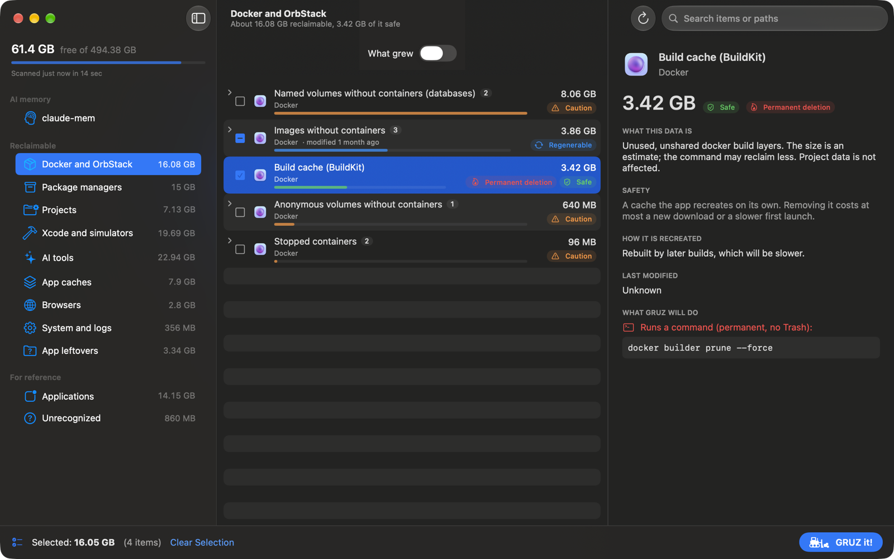

# Getting started

This page walks you through installing GRUZ, granting Full Disk Access, running the first scan and
finding your way around the main window.

## Install GRUZ

Download `GRUZ-<version>.zip` from the
[latest GitHub release](https://github.com/macolszewski/gruz_cleaner/releases/latest), unzip it
and move `GRUZ.app` to the Applications folder. GRUZ needs macOS 15 or later on Apple Silicon.

!!! note "The first launch"
    Release builds are not notarized. The first time, Control-click `GRUZ.app` in the Finder and
    choose **Open**, then confirm. Later launches work as usual.

### Build from source

You need macOS 15 or later and Xcode 26 (Swift 6.2 or later).

```sh
git clone https://github.com/macolszewski/gruz_cleaner.git
cd gruz_cleaner
./scripts/build-app.sh      # builds build/GRUZ.app
open build/GRUZ.app
```

`build-app.sh` signs the app with your first *Apple Development* certificate, so macOS keeps the
Full Disk Access grant across rebuilds. `SIGN_IDENTITY` picks another certificate; `BUNDLE_ID` and
`VERSION` are also configurable. Without a certificate the app is signed ad hoc and the permission
must be granted again after every build.

## Grant Full Disk Access

GRUZ works without extra permissions, but macOS hides some folders from apps that do not have
Full Disk Access. Without it, GRUZ cannot measure the Trash, Mail, Messages or iPhone backups, and
those locations are missing from the scan.

1. Open System Settings > Privacy & Security > Full Disk Access. The **Open Privacy Settings**
   link in the sidebar of GRUZ opens this page.
2. Add GRUZ to the list and turn it on.
3. Quit and restart GRUZ.

GRUZ checks the permission live: at launch, before every scan and whenever the app becomes active.
Until it is granted, the sidebar shows a **No Full Disk Access** note. The Access tab in
[Settings](settings.md#access) shows the current state and has a **Check Now** button.

## The first scan

GRUZ starts scanning as soon as the window opens. Results appear progressively, category by
category; the sidebar shows which stages are still running and, when the scan finishes, how long
it took.

Scanning only reads data. To scan again, click **Scan** in the toolbar, choose
**Scan > Scan Again** or press ++cmd+r++.

At the next launch GRUZ shows the saved result of the last scan ("Saved result from ...") while a
new scan runs.

## The main window



The window has three columns: the sidebar, the item list and the detail panel, with the selection
bar at the bottom.

### Sidebar

At the top, the sidebar shows the free space on your disk, how much of it is used, and when the last
scan ran. Below that:

- **AI memory**: the [claude-mem](claude-mem.md) maintenance section.
- **Reclaimable**: the categories with items you can remove, each with the size you could reclaim.
- **For reference**: Applications and Unrecognized, shown with their total size. Their items
  cannot be selected.

At the bottom, the sidebar shows notes that affect what you see: an active age filter and how many
items it hides, the missing Full Disk Access, and scan warnings (for example, when Docker is not
running).

See [Categories](categories.md) for what each category contains.

### Item list

The list shows the items of the selected category, largest first. The subtitle above it says how
much is reclaimable in the category and how much of that is safe. Each row has:

- a checkbox (a lock instead when the item cannot be removed);
- the icon of the owning app, when that app is installed;
- the title, the owner, how long ago the data last changed, and a short note;
- a size bar, colored by safety level, relative to the largest item in the list;
- the size and a safety badge: **Safe**, **Regenerable**, **Caution** or **User data**;
- a **Permanent deletion** badge when removing the item bypasses the Trash.

Groups show the number of items they contain and can be expanded. Checking a group selects all of
its removable items; a partly selected group shows a dash.

Right-click an item to **Show in Finder** or **Copy Path**.

The **What grew** switch at the top of the list filters it to items that got bigger since an earlier
scan. See [What grew](what-grew.md).

### Detail panel

Click an item to see its details:

- the size, safety badge and owner;
- **What this data is**: a plain description;
- **Safety**: what the safety level means;
- **How it is recreated**: what happens after removal, when the data comes back;
- **Notes**, for example the compose project of a Docker volume or the Git status of an agent
  worktree;
- a reminder to quit the owning app, when the app must be closed first;
- **Last modified**;
- **What GRUZ will do**: move to the Trash, delete permanently, or the exact command it runs;
- the **Path** or **Paths**, each with a button that shows it in the Finder.

### Search

The search field in the toolbar filters the current category by title, owner, path or note. When a
group matches, all its items stay visible.

### Selection bar

The bar at the bottom shows how much you have selected and in how many items. **Clear Selection**
(or **Scan > Deselect All**, ++cmd+shift+d++) clears it. Selections are kept when you switch
categories, so you can collect items from several categories at once.

**GRUZ it!** opens the review sheet for the selected items. It removes nothing by itself: see
[Removing items](removing.md).

## Next steps

- [Categories](categories.md): what GRUZ finds and how the safety levels work.
- [Removing items](removing.md): the review sheet, Trash and permanent deletion.
- [Settings](settings.md): project folders, age filters and language.
