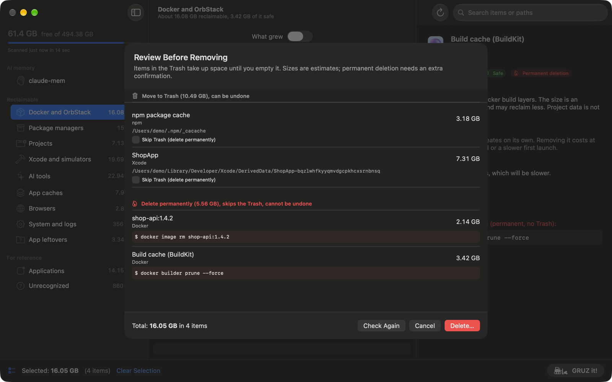

# Removing items

Nothing in GRUZ is removed by selecting it. Removal always goes through the same three steps: you
select items, review the exact operations, and confirm. This page describes each step and what
happens afterwards.

## Select

Check the items you want to remove in the item list. Nothing is preselected, and there is no
"select everything" shortcut. You can only select items that have a removal action: **User data**
items, Applications and Unrecognized show a lock instead of a checkbox.

Checking a group selects all of its removable items. Selections are kept across categories, and the
selection bar at the bottom shows the total size and the number of items. Items hidden by a search,
an age filter or the What grew switch are never acted on, even if you selected them earlier.

When you are ready, click **GRUZ it!**.

## Review

**GRUZ it!** opens the **Review Before Removing** sheet. It lists every operation that would run:

- **Move to Trash**: items whose files go to the Trash. This can be undone until you empty the Trash.
  Each row shows the title, the owner, the size and every exact path.
- **Delete permanently**: items that skip the Trash and cannot be undone. Rows for commands show
  the exact command line, for example `$ docker image rm shop-api:1.4.2`.

At the bottom, the sheet shows the total size and the number of items.

### Blocked items

When the sheet opens, GRUZ checks each operation again. A row that cannot run shows
**Will be skipped:** and the reason, for example:

- **Quit Slack first**: the app that owns the data is running. Caches of running apps are not
  touched, because the app keeps files open or would rewrite a half-removed cache.
- a path that hits the protected-path denylist;
- a command whose program cannot be found;
- for Rust targets, an active Cargo build or a running test binary (see
  [Rust and Cargo](rust.md#checks-before-removal)).

Quit the app and click **Check Again** to refresh the checks. Blocked items are skipped; the rest
still run. The checks are repeated for each operation right before it runs.

### Skip Trash

Each Trash row has a **Skip Trash (delete permanently)** checkbox. Turning it on moves the item to
the Delete permanently section. Use it when you need the space back immediately and are sure about
the item; otherwise leave it off.

## Confirm

The button at the bottom right depends on what the plan contains:

- **Move to Trash** when everything goes to the Trash. One click runs the plan.
- **Delete…** when anything is permanent. It opens a second alert,
  **Confirm Permanent Deletion**, which says how many items will be deleted permanently and how many
  will go to the Trash. Only its button **Delete *size* Permanently** (with the total size of the permanent operations) runs them.

**Cancel** closes the sheet without changing anything.

### Permanent deletion

These operations bypass the Trash:

- Docker images, containers and volumes (`docker image rm`, `docker container rm`,
  `docker volume rm`) and the BuildKit cache (`docker builder prune --force`);
- simulators (`xcrun simctl delete`);
- a tool's own clean command, such as `uv cache clean`;
- items you switched to **Skip Trash**.

They are marked with a **Permanent deletion** badge in the item list and in the detail panel, and
always need the extra confirmation. GRUZ runs only commands from a fixed allow-list; see
[Architecture](../reference/architecture.md#safety-model).

## After removal

While the plan runs, the sheet shows progress. Docker and cache commands can take a few minutes.
When it finishes, the result lists each operation as done, partly done (some of its paths could not be
removed; they are listed and stay in the item list), skipped (with the reason) or failed (with the
error and the command output, if any).

A Docker command is skipped when the `docker` CLI now talks to a different engine than the one that
was scanned (for example after `docker context use`), and an image is skipped when its tag now points
to a different image. Scan again to see the current state.

GRUZ will not quit, and will not start a scan, while a removal is running.

At the top, GRUZ reports the measured change in free space on the disk. This is more honest than the
sum of estimated sizes, which can overlap (see [Limitations](../reference/limitations.md#sizes-are-estimates)).

!!! warning "Empty the Trash to get the space back"
    Files moved to the Trash stay on the same disk. They free up space only after you empty the Trash.
    Until then, you can put anything back from the Trash with **Put Back** in the Finder.

OrbStack returns space freed by Docker to macOS gradually, over a few minutes, so the free space may
grow after the sheet closes.

**Close and Scan Again** closes the sheet and starts a new scan.

## Operation log

Every confirmed operation, including skipped, failed and partly done ones, is appended as one JSON
line to `~/Library/Logs/GRUZ/operations.log`: the time, the item, its size, the action with exact paths
or command, the status with the paths that failed, and the command output. Each operation is also
recorded right before it starts. If the log cannot be written, nothing is removed; if it stops working
partway, the remaining operations are skipped. The result sheet shows the log path, and
**Show Operation Log in Finder** in [Settings > Access](settings.md#access) opens it.
