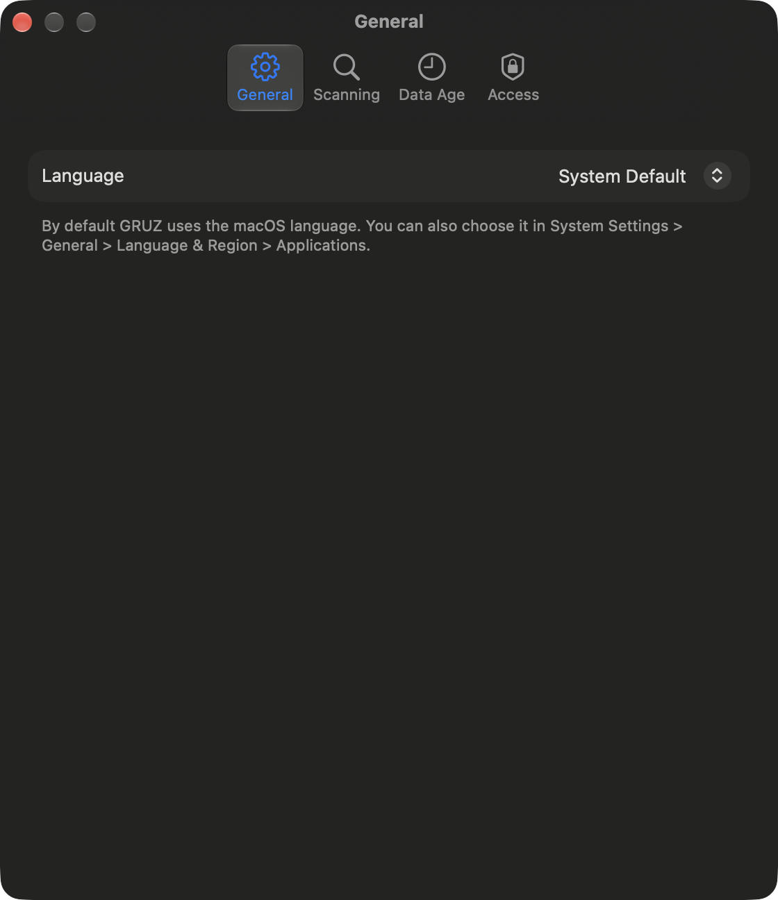

# Settings

Open Settings with **GRUZ > Settings…** or ++cmd+comma++. Settings has four tabs: General,
Scanning, Data Age and Access.

## General

**Language** chooses the interface language: **System Default**, **English** or **Polski**. Item
descriptions follow the same language. By default GRUZ uses the macOS language; you can also choose
it per app in System Settings > General > Language & Region > Applications.

A new language applies after GRUZ restarts. **Restart Now** relaunches the app; it is unavailable
while a removal or claude-mem maintenance is running.

## Scanning

### Project folders

The folders GRUZ searches for project artifacts such as `node_modules`, `.venv`, build output and
agent worktrees, and for Rust `target` folders. The default list is whichever of `~/Developer`,
`~/workspace`, `~/Projects`, `~/code`, `~/src`, `~/dev` and `~/repos` exist, or `~/Developer` when
none does.

- **Add Folder…** adds one or more folders.
- The minus button removes a folder from the list. The folder itself is not deleted.

The project folders themselves and your source code are always protected; only recognized artifacts
inside them can be removed.

### Unrecognized

**Show folders larger than ... MB** sets the minimum size of folders listed in the Unrecognized
category. The default is 100 MB.

**Scan Again with New Settings** starts a new scan, so changes to this tab take effect.

## Data Age

### App-wide filter

**Only show data older than…** hides everything that changed recently, in all categories. Age is the
time since anything in the folder last changed (creation time for Docker images, last boot for
simulators). Items without a date are always shown. The filter is off by default.

### Default item thresholds

Some items show only older data by default, because they are valuable while fresh:

| Item | Default |
|---|---|
| Claude Code session transcripts | 30 days |
| Claude Code file history | 30 days |
| Codex sessions | 30 days |
| Packages downloaded by npx | 30 days |
| superwhisper recordings | 30 days |
| User temporary files | 7 days |

Each threshold can be changed or turned off. When the app-wide filter is also on, the longer
threshold applies.

When age filters hide anything, the sidebar says how many items are hidden and links to this tab.
The [What grew](what-grew.md) switch ignores age filters.

## Access

**Permissions** shows whether GRUZ has Full Disk Access. Without it, GRUZ cannot measure the Trash,
Mail, Messages or iPhone backups. **Open Privacy Settings** opens the right page in System Settings;
add GRUZ to the list, then restart it. **Check Now** checks the permission again.

**Safety** summarizes how GRUZ removes data, and **Show Operation Log in Finder** opens the
[operation log](removing.md#operation-log).

## Where settings are stored

| Data | Location |
|---|---|
| Settings (project folders, age filters, unrecognized threshold) and the language (`AppleLanguages`) | the app's `UserDefaults` |
| Last scan, shown at launch | `~/Library/Application Support/GRUZ/last-scan.json` |
| Size history for What grew | `~/Library/Application Support/GRUZ/usage-history-v1.json` |
| Operation log | `~/Library/Logs/GRUZ/operations.log` |
| claude-mem backups | `~/Library/Application Support/GRUZ/ClaudeMemBackups/` |
