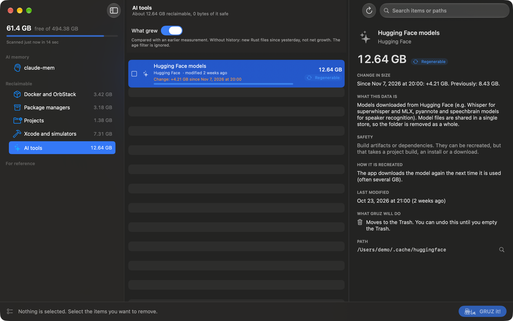

# What grew

Most of the time the question is not "what is old" but "what got bigger since yesterday". The
**What grew** switch at the top of the item list answers it. It works in every category.

## Using it

Turn on **What grew** above the item list. The list then shows only items that grew compared with
an earlier scan, sorted by how much they grew. Each row shows the change and the date of the scan it
is compared with, for example "Change: +2.4 GB since ...". The detail panel shows the same comparison
under **Change in size**, with the earlier size.

With the switch on, age filters are ignored, so recent growth is visible even when the data is newer
than your age thresholds. Turn the switch off to return to the normal list.

## How it works

After every complete scan, GRUZ stores a compact snapshot (item id and size) in
`~/Library/Application Support/GRUZ/usage-history-v1.json`.

- **Scope.** Snapshots are compared only when they share a scope: the same project folders and the
  same Full Disk Access state. Changing your project folders starts a new history.
- **Baseline.** The latest comparable snapshot taken before the start of today; if there is none, the
  latest earlier one from today.
- **Growth.** For each item, the size now minus the size in the baseline. A group gets the sum of its
  items when they all share one baseline.
- **Retention.** Up to 30 days, the latest snapshot per day and scope, at most 90 snapshots in total.

A scan with warnings (for example, when Docker did not respond) is incomplete. It is neither stored
nor compared, so it cannot become a misleading baseline.

## The first days

History starts with the first complete scan, so on the first day there is nothing to compare with.
Rust components are the exception: when a component has no baseline, it is still shown if it
contains files created since the start of yesterday, marked "New since yesterday: ... · no baseline".
That is not net growth: files may have been rewritten, moved or deleted in between. See
[Rust and Cargo](rust.md#what-grew).
