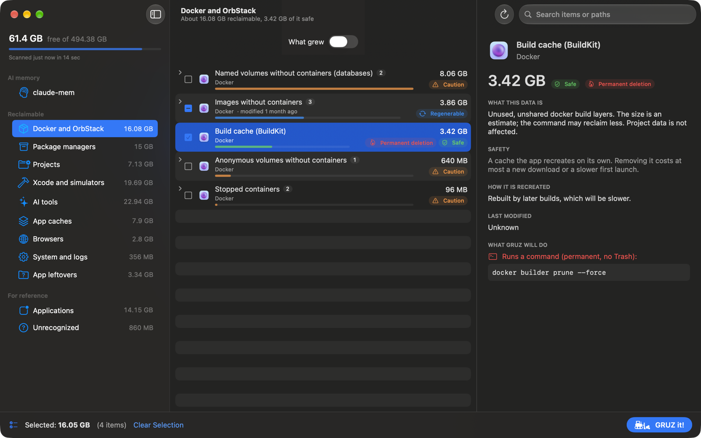
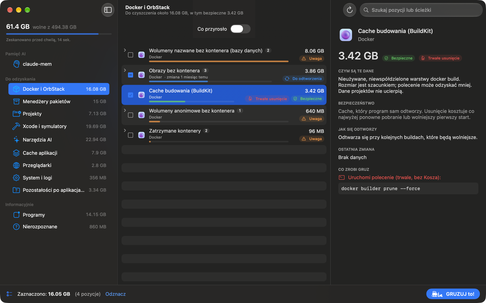

---
hide:
  - navigation
---

# GRUZ

Godlike Rubbish Ultra-Zapper

A macOS app that digs through caches, build junk, Docker leftovers and remains of apps you uninstalled years ago, tells you what each item is, and zaps only what you approve. Trash first, no surprises.

[Download](https://github.com/macolszewski/gruz_cleaner/releases/latest){ .md-button .md-button--primary }
[Get started](guide/getting-started.md){ .md-button }

*Gruz* is Polish for rubble: the stuff left behind after the building is done. GRUZ scans your
home folder for that kind of data, groups it into categories and explains every item: what the data
is, how risky it is to remove and how it comes back. You pick what goes. GRUZ shows you the exact
paths and commands, and by default moves files to the Trash.

## What it does

- **Finds the big leftovers**

    ---

    Package manager caches, Xcode DerivedData, simulators, Android images, AI model caches,
    browser and app caches, logs.

    [:octicons-arrow-right-24: Categories](guide/categories.md)

- **Cleans your projects**

    ---

    `node_modules`, `.venv`, `bin`/`obj`, build output and stale agent worktrees in your project
    folders, recognized by context, not by name alone.

    [:octicons-arrow-right-24: Projects](guide/categories.md#projects)

- **Handles Docker properly**

    ---

    Unused images, stopped containers, unused volumes and BuildKit cache for Docker Desktop and
    OrbStack, removed one by one through the `docker` CLI.

    [:octicons-arrow-right-24: Docker and OrbStack](guide/categories.md#docker-and-orbstack)

- **Trims Rust targets**

    ---

    Splits Cargo `target` folders into profiles and components, keeps release binaries and refuses
    to run during an active build.

    [:octicons-arrow-right-24: Rust and Cargo](guide/rust.md)

- **Shows what grew**

    ---

    Compares the scan with earlier ones and lists only what got bigger since yesterday.

    [:octicons-arrow-right-24: What grew](guide/what-grew.md)

- **Maintains claude-mem**

    ---

    Prunes the memory database of the claude-mem agent plugin by date and project and rebuilds its
    indexes, with a backup.

    [:octicons-arrow-right-24: claude-mem maintenance](guide/claude-mem.md)

## The safety promise

- **Scanning is read-only.** Nothing is selected for you.
- **You review before anything happens.** **GRUZ it!** opens a review sheet with every exact path
  and command and the total size. Only your confirmation runs it.
- **Trash first.** Files go to the Trash by default. Permanent removal (Docker commands, a tool's own
  clean command, or **Skip Trash**) is marked on the item and in the review sheet, and asks once more.
- **Protected paths win.** A hard-coded denylist (your home folder, Documents, Desktop, `.git`
  folders, project sources, system folders) overrides every rule.
- **Apps must be closed.** Caches of a running app are not touched.
- **Unknown stays untouched.** Folders no rule describes are shown, but cannot be removed.
- **No automation can delete.** The command line tool can only scan and report.
- **Everything is logged** to `~/Library/Logs/GRUZ/operations.log`.

The design behind these points is in [Architecture](reference/architecture.md#safety-model).

## In your language

GRUZ is available in English and Polish, both the interface and the descriptions of every item.
It follows the macOS language by default; you can switch it in [Settings](guide/settings.md#general).

## Requirements

- macOS 15 or later on Apple Silicon.
- Optional: Full Disk Access, to measure the Trash, Mail, Messages and iPhone backups.

GRUZ is open source, created by [Maciej Olszewski](https://github.com/macolszewski). Bug reports,
new rules and translations are welcome: see
[CONTRIBUTING.md](https://github.com/macolszewski/gruz_cleaner/blob/main/CONTRIBUTING.md) and the
[rule catalog](reference/rules.md).
